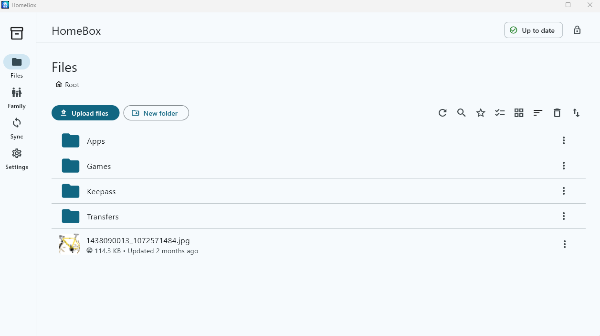

# HomeBox

[](https://github.com/nyver/homebox/actions/workflows/ci.yml)

HomeBox is a self-hosted, zero-knowledge file-storage service for a small family.
Its security boundary is deliberate: clients encrypt file content and sensitive metadata before upload; the server stores only opaque identifiers, encrypted metadata/key envelopes, and ciphertext blobs. It never receives a File DEK, vault key, folder key, user master key, or recovery secret.

This repository currently provides the security-first Go server foundation, a Windows 11 Flutter desktop client, and an Android client. The client authenticates against the server over pinned TLS, creates its own E2EE vault, and can browse, upload, and download real encrypted files against the live server API from its UI. Folder create/rename/move/delete go through a local SQLite cache and durable outbox, so they apply instantly and work offline, syncing to the server opportunistically in the background. An optional local sync folder mirrors the vault's decrypted contents to disk automatically; its native filesystem watcher debounces local edits and new nested folders into an immediate safe pull-then-push sync pass. Sync can be paused and resumed from the desktop UI without cancelling an in-flight write. Closing the Windows window moves HomeBox to the notification area, where its icon can restore the UI or exit explicitly. Settings offers opt-in per-user Windows autostart.



## Current capabilities

- Windows enforces one HomeBox instance per user session; launching HomeBox again restores the already running window, even when it is hidden in the notification area, while the local sync folder propagates deletion of directories that were previously materialized on that device. Temporary refresh failures preserve the saved mobile login for a later retry.
- Android network timeouts leave sync offline and retain the durable outbox/session for automatic retry; the server must be reachable by its LAN or VPN address on TCP 8787, not Android's own `localhost`.

- Safe YAML configuration with mandatory E2EE and no server decryption mode.
- Versioned SQLite migrations (WAL, foreign keys) instead of an inline schema dump.
- Persistent ECDSA P-256 server transport identity and a SHA-256 fingerprint (P-256, not Ed25519 — Dart's bundled TLS client rejects Ed25519 certificates; see ADR-008).
- **Secure Transport is closed (ADR-008/009):** the server terminates TLS 1.3 using a self-signed certificate derived from its identity key. There is no plaintext HTTP mode in any configuration. Clients trust the connection by pinning the identity fingerprint, not a certificate authority. With `server.tls.enabled` the server serves an operator-supplied certificate instead; it must use an ECDSA P-256 key (the server refuses to start otherwise), TLS 1.3 is still required, and `homebox fingerprint` then prints the fingerprint of that certificate's key, which clients pin. Renew such a certificate with the same key, or every client has to verify a new fingerprint.
- Argon2id password hashing, a first-admin bootstrap command, and a full authenticated session lifecycle: login, refresh-token rotation, logout, and device registration/revocation (`/api/v1/auth/*`, `/api/v1/devices*`). Login is timing-safe against username enumeration and rate-limited with exponential backoff per username *and* client address (one attempt at a time), with a milder per-username backoff across all addresses (at most 30 seconds, so a stranger failing logins cannot lock the owner out) and a per-address limit against password spraying; the limiter's memory is bounded, and Argon2id runs outside any database transaction with at most two hashes at once, so a login flood cannot stall other requests. A refresh retried within one minute of a lost response is reissued instead of forcing a new login, while a rotated refresh token presented later is treated as theft and ends every session of that device. A refresh cuts the device's previous access token short to one minute, and logout ends the device's access tokens immediately.
- Authenticated key-envelope delivery between a user's own trusted devices (`/api/v1/devices/{id}/key-envelope`): a Vault-Key-derived Ed25519 Account Identity signs each approved X25519 device key, first pairing requires an out-of-band SHA-256 fingerprint comparison, and provisioning v2 binds that certificate into HKDF so a malicious server cannot remove or substitute it. Uncertified legacy v1 envelopes are refused by both the server and the receiving client, because they would let anyone holding the account password, or a malicious server, plant a Vault Key of their own choosing; a device left with a pending v1 approval must be approved again.
- **Family Vault (spec §28, ADR-023):** a folder can be shared with other family accounts on the same server as **View only** (`READ`) or **Can edit** (`READ_WRITE`). Each shared folder gets its own random Folder Key; the owner's client re-encrypts the folder's metadata and rewraps every File DEK under it (ciphertext blobs never change), and encrypts the key separately for every certified device of each member. Envelopes are signed by the owner's account identity, and both sides compare account fingerprints once, so the server can neither read a shared folder nor plant a key of its own. Removing a member ends their server access at once and rotates the folder key, so they cannot read anything added afterwards. See [Share folders with family](#share-folders-with-family).
- Android file actions include Share: HomeBox decrypts the selected file into its private cache and passes a read-only temporary URI to the Android share sheet, so it can be sent to apps such as Telegram. Temporary copies are removed on a later share attempt after one hour.
- Opaque node CRUD (create/rename/move/soft-delete/restore/Trash) with optimistic concurrency and idempotent mutation (`/api/v1/nodes*`, `/api/v1/trash`), and a paged, per-account sync revision feed (`/api/v1/sync/changes`). Restoring an item whose folder is still in Trash places it in the root instead, so it is visible and is not purged later together with that folder.
- Ciphertext-only resumable upload wired end to end: create/chunk/complete/abort over HTTP (`/api/v1/uploads*`) and streamed unmodified back on download (`/api/v1/files/{id}/content`), with opaque IDs, per-chunk SHA-256 storage checks, idempotent completion, and atomic blob commit. Client-chosen blob and file-version IDs are reserved when a session is created and must be canonical lowercase UUIDs; a blob file is created exclusively and never replaces another version's ciphertext. Chunk count and chunk size are bounded when the session opens and checked again per chunk. Uploads lock per session, so concurrent uploads from different devices proceed in parallel. Downloads answer `Range`/`If-Range` requests (the file-version ID is the ETag), and clients resume an interrupted download from the bytes they already received.
- A 500 MiB plaintext file limit. The Flutter upload path hashes, encrypts, and transfers one 4 MiB frame at a time, keeping memory bounded and rejecting a file changed during upload.
- A unified error-mapping layer (`internal/httpapi`'s `writeServiceError`) that only ever returns a raw error message to the client when a domain service explicitly marked it safe to show (`internal/apierror.Validation`) — every other failure logs server-side and returns a generic `INTERNAL_ERROR`, so a database/driver error can never leak through the API. The server log line carries the same `requestId` the client receives, so a reported error can be traced. The SQLite pool serves concurrent readers in WAL mode while write transactions start `IMMEDIATE`; `SIGINT`/`SIGTERM` (including `docker stop`) shut the server down gracefully.
- Health and metrics endpoints.
- **Server-held recovery (spec §10.12):** each account's recovery bundle — its Argon2id-protected Recovery Package plus the Vault Key wrapped by the User Master Key — is stored as opaque ciphertext (`/api/v1/users/me/recovery`), so the `HBXR1-...` Recovery Secret alone restores the vault on a clean device even when every trusted device is lost. The server accepts a bundle only when it is signed by the account's Ed25519 identity (the one already established by signed device certificates), so a stolen session that lacks the Vault Key cannot replace a working bundle.
- **File version retention (spec §27.1):** maintenance keeps at most `maintenance.max_file_versions` versions per file (10 by default, counting the current one) and removes non-current versions older than `maintenance.version_retention_days` (30 by default). The current version is never removed, and the ciphertext of pruned versions goes through the normal two-pass blob GC.
- **Sync conflict resolution (spec §21, ADR-022):** sync never discards content. The sync folder replaces or removes a local file only when it provably still holds what this device last synchronized (unchanged size and timestamp, or the recorded plaintext SHA-256). A concurrent edit, a same-name file from another device, or an edit to a file deleted elsewhere is kept as `<name> (conflict - <device> - <UTC time>)<ext>` and uploaded as a separate file whose encrypted metadata explains the conflict. Offline renames and moves that lose a revision race are replayed onto the server's newer state when they do not collide (a rename re-encrypts the server's current content hash, so a concurrent content update is never undone); colliding renames/moves keep the server state, and a delete never removes an item changed elsewhere. Several offline changes to the same item are chained onto each other's revisions instead of failing. Every resolved conflict is listed on the Sync page (with a badge on its navigation icon) until dismissed, conflict copies are marked in Files, and **Mark conflict resolved** clears a copy's marker.
- **Bulk actions:** on Windows and Android, **Select** in the Files toolbar (or a long press on any row) shows checkboxes; any mix of files and folders, or **Select all**, can then be moved to Trash, moved to another folder (**Move to…** opens a folder picker), downloaded, or added to favorites in one step. Moves and Trash work like their single-item versions: applied immediately and queued in the durable offline outbox, and a folder takes its contents along, so an item inside a selected folder is not handled separately. **Download** saves to a folder with the folder structure kept or as one ZIP archive on Windows, and as a ZIP archive through the Save dialog on Android; every file is verified against its encrypted hash, files are decrypted one at a time so memory stays bounded, existing names are never overwritten, and temporary plaintext copies are removed. Android's back gesture leaves selection mode first, then goes up one folder at a time, and only leaves the app from the root. On Windows, hovering a row with the mouse shows its checkbox, Ctrl+click toggles an item, and Shift+click selects a range. The same selection works in an opened shared folder under **Family** (download for every member; move and Trash with **Can edit**), and in **Trash**, which restores or permanently deletes several items at once.
- **Search:** the Files toolbar's search finds any part of a file or folder name, case-insensitively and in any language, with several words matching all of them. It runs on this device over a SQLite FTS5 trigram index of decrypted names that lives in memory only, so neither the server nor the local disk ever holds plaintext names for it; the index is built on the first search and then only re-reads items that changed. Selecting a hit opens its folder.
- **Favorites:** **Add to favorites** in a file or folder menu (or for a selection) marks it with a star; the Favorites view in the Files toolbar lists them with their folders. Favorites are stored on the server as opaque (account, node) pairs, synchronized to every device on each sync pass, hidden while their item is in Trash or no longer shared, and removed when it is purged.
- **Delete permanently:** Trash items can be deleted right away instead of after the retention period (`DELETE /api/v1/trash/{id}`), with exactly the cleanup the scheduled purge performs.
- **Trash and version history in the client:** the Files page opens a Trash view that lists deleted items with their original folder and restores them (together with any deleted parent folders, outermost first) through the offline outbox; a restore that would create a second item with the same name is refused. Each file's **Version history…** lists its stored versions and can save any of them or restore one, which uploads it as a new current version so history is never rewritten.
- Atomic ciphertext-only server backup and safe restore commands. A backup contains a consistent SQLite snapshot, immutable ciphertext blobs, the transport identity key, the supplied server config, and a SHA-256 manifest. It never contains a Recovery Secret or client private E2EE key.
- Automatic server maintenance that permanently removes Trash entries after three days, cleans expired sessions, abandoned upload ciphertext, and idempotency records, and removes unreachable ciphertext blobs only after a two-pass grace period. It never decrypts content. The same pass remains available as a manual command.
- Windows users can open the selected local sync folder directly from the Sync page or the HomeBox notification-area menu; the tray action stays disabled until a folder is selected. A materialized file's Files-menu action can also open its containing folder in Explorer.
- On Windows, tapping a file that is already mirrored in the local sync folder opens that local copy in its default application (Windows shows its app chooser when none is associated; executable, script, shortcut, installer, and disk-image types — plus anything Windows itself classifies as dangerous — are refused with a hint to use Save as). Edits saved by the application, for example a KeePass database, are detected by the sync-folder watcher and uploaded as a new file version. Editor lock and temporary files (`~$*`, `*.kdbx.lock`) are never uploaded.

## Run the server foundation

Copy [config.example.yaml](config.example.yaml) to `config.yaml` and choose a durable `storage.path`. `server.read_timeout` bounds the complete request read, including upload-chunk bodies; its two-minute default is intended to tolerate slow private-network links without leaving body reads unbounded.

```powershell
go build -o bin/homebox.exe ./cmd/homebox
./bin/homebox.exe fingerprint --config config.yaml
"a-long-unique-password" | ./bin/homebox.exe bootstrap-admin --config config.yaml --username admin --password-stdin
"another-long-password" | ./bin/homebox.exe create-user --config config.yaml --username family-member --password-stdin
./bin/homebox.exe server --config config.yaml
```

Every endpoint, including health and metrics, is served over TLS — there is no separate plaintext port:

- `GET /health/live`
- `GET /health/ready`
- `GET /metrics`
- `POST /api/v1/auth/{login,refresh,logout}`
- `GET /api/v1/users/me`
- `GET`/`PUT /api/v1/users/me/recovery` (opaque recovery bundle; `PUT` requires an account-identity signature)
- `GET /api/v1/users/{id}/share-devices`
- `POST /api/v1/shares` (`READ` or `READ_WRITE`, signed per-device envelopes), `GET /api/v1/shares/{incoming,outgoing}`, `POST /api/v1/shares/{id}/envelopes`, `DELETE /api/v1/shares/{id}`
- `GET /api/v1/folder-keys`, `POST /api/v1/nodes/{id}/folder-keys` (owner-wrapped Folder Key versions)
- `POST /api/v1/nodes/rekey` (move nodes into another key scope with client-side re-encrypted metadata and rewrapped File DEKs)
- `GET /api/v1/devices`, `DELETE /api/v1/devices/{id}`
- `POST` / `GET /api/v1/devices/{id}/key-envelope`
- `POST /api/v1/nodes`, `GET /api/v1/nodes/{id}`, `GET /api/v1/nodes/children?parentId=&ownedOnly=&limit=&after=` (with `limit`, up to 1000, the `X-Next-After` response header carries the cursor for the next page), `PATCH`/`DELETE /api/v1/nodes/{id}`, `POST /api/v1/nodes/{id}/restore`, `GET /api/v1/trash`, `DELETE /api/v1/trash/{id}` (permanent delete of one Trash entry and its subtree)
- `GET /api/v1/favorites`, `PUT`/`DELETE /api/v1/favorites/{id}`
- `GET /api/v1/sync/changes?after=&pageSize=`
- `POST /api/v1/uploads`, `GET`/`DELETE /api/v1/uploads/{id}`, `PUT /api/v1/uploads/{id}/chunks/{chunkNo}`, `POST /api/v1/uploads/{id}/complete`
- `GET /api/v1/files/{id}/content?versionId=` (supports `Range`/`If-Range`)
- `GET /api/v1/files/{id}/versions`

The fingerprint must be verified out of band before a client trusts the server identity (ADR-009); a client must refuse to connect if the presented certificate resolves to a different fingerprint than the one it pinned. The certificate is self-signed but uses ECDSA P-256, which is broadly supported (Go, the Flutter client's bundled BoringSSL, OpenSSL, and Windows' own Schannel stack all complete the handshake), so ordinary tools like `curl.exe -k` work for manual poking as long as certificate verification is disabled — there is no CA behind this certificate on purpose.

## Deploy the server to a VPS with Docker Compose

The repository includes a multi-stage [Dockerfile](Dockerfile) and [docker-compose.yml](docker-compose.yml). Compose starts the server as an unprivileged user, gives it a dedicated persistent volume for the SQLite database, server transport identity, and ciphertext only, and mounts its non-secret configuration read-only from [docker/homebox.yaml](docker/homebox.yaml). It exposes the server's own pinned TLS endpoint directly; do not place a plaintext reverse proxy in front of it.

On the VPS, install Docker Engine with the Compose plugin, allow TCP 8787 through the VPS firewall, then run:

```sh
docker compose build
docker compose up -d
docker compose exec homebox /homebox fingerprint --config /etc/homebox/homebox.yaml
read -r -s HOMEBOX_ADMIN_PASSWORD
printf '%s' "$HOMEBOX_ADMIN_PASSWORD" | docker compose exec -T homebox /homebox bootstrap-admin --config /etc/homebox/homebox.yaml --username admin --password-stdin
unset HOMEBOX_ADMIN_PASSWORD
```

Verify the printed fingerprint out of band before connecting a client. The named `homebox-data` volume is the only persistent server state; back it up using HomeBox's `backup` command, not a plaintext export. To bind only to a private VPN address instead of every VPS interface, set `HOMEBOX_BIND_ADDRESS` before `docker compose up -d`. Edit `docker/homebox.yaml` only for server policy changes; it retains mandatory E2EE and a 500 MiB plaintext / 524,290,000-byte ciphertext cap.

## Back up and restore the server

Run backups against a live server or after it has stopped. The SQLite snapshot is created with SQLite's `VACUUM INTO` mechanism, so the database image is consistent with WAL mode. Store backup directories outside `storage.path`; HomeBox refuses a nested destination to avoid recursive backups.

```powershell
./bin/homebox.exe backup --config config.yaml D:\backups\homebox-2026-08-28
```

The destination must be new. The command intentionally excludes incomplete upload temp data, but includes all committed immutable ciphertext blobs, the server transport identity, the exact supplied configuration file, and a manifest containing SHA-256 checksums.

To restore, prepare a configuration whose `storage.path` is a new, absent directory. The command validates the manifest, every copied file, the server identity, SQLite integrity, and every database-referenced ciphertext blob before atomically placing the restored storage there. It never overwrites existing server data.

```powershell
./bin/homebox.exe restore --config recovery-config.yaml D:\backups\homebox-2026-08-28
./bin/homebox.exe server --config recovery-config.yaml
```

Verify the server's pinned fingerprint before reconnecting a client. A server backup alone cannot decrypt or recover files: retain at least one trusted client or the user's Recovery Secret separately and offline.

## Run maintenance / ciphertext GC

The server runs maintenance once at startup and then every `maintenance.interval_hours` (one hour by default). Trash entries older than `maintenance.trash_retention_days` (three days by default) are permanently removed with their complete subtrees, file versions, shares, favorites, and stale upload records. File versions are pruned in the same pass: each file keeps at most `maintenance.max_file_versions` versions including the current one, and non-current versions older than `maintenance.version_retention_days` are removed; the current version is never touched. Ciphertext that becomes unreferenced enters two-phase GC: the first pass marks it, and a later pass deletes it only after `maintenance.orphan_blob_grace_hours` has elapsed and it is still unreachable. This preserves the ciphertext-only security boundary and protects against transient storage divergence.

An operator can also invoke the same maintenance pass manually:

```powershell
./bin/homebox.exe maintenance --config config.yaml
```

## Server storage

With `storage.path: ./data`, HomeBox creates:

```text
data/
  database/homebox.db       SQLite: accounts, opaque metadata and ciphertext envelopes
  blobs/<blob-id>.hbxblob  immutable E2EE ciphertext only
  temp/uploads/            uncommitted E2EE ciphertext chunks only
  keys/server_identity.key transport identity only, never a file key
```

Do not place recovery material or client E2EE private keys in this directory. Backups of the server data remain ciphertext-only and cannot recover plaintext without a trusted client or the user's recovery secret.

## Development checks

These checks, plus `flutter analyze`/`flutter test`/`flutter build` for the Windows and Android clients, also run in CI on every push and pull request ([.github/workflows/ci.yml](.github/workflows/ci.yml)).

```powershell
gofmt -w cmd internal
go test ./...
go vet ./...
go build ./cmd/homebox
```

## Client foundation

For Android files already mirrored to a selected sync folder, HomeBox opens an `ACTION_VIEW` chooser using the file's MIME type. If encrypted metadata from an older client has only the generic `application/octet-stream` type, HomeBox derives a safe best-effort type from the file name, including `application/vnd.android.package-archive` for `.apk`; this lets compatible image viewers and Android's APK installer appear in the chooser. On Android 8 and newer, HomeBox opens the per-app "Install unknown apps" setting when APK installation has not yet been allowed; the user must grant it and open the APK again.

Every key the client uses for node metadata and File DEKs comes from a key ring (`core/e2ee/key_ring.dart`): the account's personal Vault Key plus every version of every Folder Key it created, which stay wrapped by the Vault Key in the local database (`core/storage/folder_keys_store.dart`) until needed, so shared folders also work offline. Each node records its key scope; `features/sharing/key_scopes.dart` puts new content below a shared folder into that folder's scope, and `features/sharing/shared_scope_reconciler.dart` rekeys anything that ends up there in the personal scope after every sync pass. `features/sharing/family_vault_controller.dart` drives sharing, fingerprint verification, key delivery to new member devices, and rotation; `features/sharing/shared_folder_browser.dart` lets a member browse, download, and (with **Can edit**) change a folder shared with them.

The Flutter client is in [client](client). It builds for Windows 11 and Android. Android declares `INTERNET` for pinned-TLS server access, requests `CAMERA` only when the user taps Camera in Files, and declares `USE_BIOMETRIC` to lock the app once at launch; it does not request broad device storage or gallery access. The Files page's **Upload files** action opens the system picker with multiple selection enabled, then encrypts and uploads the chosen files sequentially. Transfers run one at a time, but starting another upload or download while one is running queues it instead of rejecting it; the header shows how many are waiting. Errors are shown as plain sentences rather than exception text, a TLS failure is reported as a pinned-identity change only when the certificate actually failed the pin, and requests time out instead of hanging on a stalled connection. File encryption and Recovery Secret key derivation run on background isolates so the UI stays responsive. Image previews are cached as small thumbnails, and on Windows a preview of a file already mirrored in the sync folder is read from disk instead of downloaded. A conflict with an existing name is resolved for each file, and a failed item does not prevent later selected files from uploading. On Windows, a successful Files-page upload copies its source into the corresponding sync-folder location; the materializer verifies the plaintext hash and records that local copy instead of downloading the same ciphertext back from the server. Completed explicit downloads and sync-folder downloads on both Windows and Android appear as separate in-app notifications that show the file name and saved location; up to three stay visible at the same time, can be dismissed independently, and close automatically. Android sync-folder notifications identify the selected folder and relative path because the Storage Access Framework intentionally does not expose an absolute filesystem path. The biometric gate is used only when the device has an enrolled biometric method, and it keeps the UI hidden until the check succeeds. It is deliberately not re-checked on every background/foreground cycle because system file pickers, camera capture, and Save As briefly background the app as part of their normal operation. Camera photos stay in app-private temporary storage until they enter the same encrypted upload flow as other files. The header exposes sync, vault-lock, and transfer status consistently across sections. Android pull-to-refresh runs the same sync action as the Sync page, and tapping a file in Files opens the OS Save As picker. Android local sync folders use a persisted Storage Access Framework tree grant and require no broad "All files access" permission; because SAF provides no reliable recursive watcher, Android polls its mirrored files for edits instead of watching the folder, and does not upload new or deleted local files. Windows uses a native folder picker, bidirectional filesystem watching, a notification-area icon, and opt-in autostart. Device registration reports the correct `ANDROID` or `WINDOWS` platform, and all credentials and file content travel over pinned TLS.

The Settings page's "Connect to a HomeBox server" flow discovers a server's identity fingerprint (without trusting it), requires the user to explicitly confirm it before pinning, then supports login/logout. `core/transport/pinned_http_client.dart` mirrors the Go server's fingerprint-pinning logic: it strictly walks the leaf certificate's DER structure to the exact SubjectPublicKeyInfo field, accepts only an ECDSA P-256 uncompressed public key, hashes that point with SHA-256, and refuses the connection on any mismatch. The TLS client uses an empty trust store so even a publicly trusted certificate must pass the pin; certificate-authority validation can never bypass it. A device ID and refresh token are persisted (`flutter_secure_storage`) so the app restores its session silently on restart; the short-lived access token is not persisted and is re-derived via refresh. Server login only proves account identity — it never unlocks the E2EE vault (ADR-012), and the UI reflects that as a separate "Signed in" vs. "Vault locked" state. `ServerConnectionController` also renews the access token itself in the background, shortly before its own `session_max_age` lifetime (15 minutes by default) elapses, so a client left open and idle no longer surfaces a stale-token 401 on its next Files/Sync call; a rejected renewal (an expired or revoked refresh token) falls back to "Signed in" being cleared, the same as any other expired session.

The client E2EE core now defines protocol-v1 file headers and independently encrypts 4 MB chunks with XChaCha20-Poly1305. Each file version uses a random 256-bit File DEK and a 128-bit nonce prefix; the big-endian chunk number completes the 192-bit nonce. AAD binds the protocol version, opaque file-version ID, chunk number, and total chunk count. Fixed vectors and tamper tests protect the protocol contract.

File DEKs and vault/provisioning keys are serialized only as versioned XChaCha20-Poly1305 envelopes. Envelope AAD binds the purpose, key version, vault/folder scope, and subject file/device ID, so the server cannot substitute an envelope into a different context. Temporary extracted key buffers are erased after wrapping or unwrapping.

Sensitive node metadata is also encrypted client-side. Protocol-v1 metadata envelopes contain NFC-normalized portable filenames, MIME types, plaintext hashes, conflict details, and labels. AAD binds each envelope to its opaque node ID, node type, key scope, and key version. Windows reserved names and non-portable path characters are rejected before encryption, while case is preserved for display and compared through a normalized case-insensitive key.

Recovery uses a random 256-bit printable `HBXR1-...` Recovery Secret that is never uploaded. Clients derive a package key with Argon2id (19 MiB, two iterations), encrypt the User Master Key with XChaCha20-Poly1305, and bind the package to the account's opaque user ID. The Vault Key is wrapped by the User Master Key in a key envelope bound to the account, and both are uploaded together as a versioned recovery bundle (`core/e2ee/recovery_bundle.dart`). The upload is signed by the Ed25519 Account Identity over the account ID and the bundle's SHA-256; the server checks that signature against the identity it already trusts and otherwise stores the bundle unread. A server backup alone cannot restore plaintext; recovery requires this secret or an existing trusted device.

**Vault bootstrap** (`core/e2ee/vault_key_store.dart`, `features/vault/vault_setup_controller.dart`) fills in the one step ADR-011/013 described but didn't implement: creating the very first device's vault, with no existing trusted device or Recovery Package to restore from. The Settings page's "Create vault" action generates a random User Master Key and Vault Key together, persists both directly via OS secure storage (the same way the device identity key is stored — at-rest confidentiality comes from the OS layer, not a second wrapping pass), creates the Recovery Secret + Recovery Package, and shows the secret exactly once behind an explicit "I have saved this" confirmation before the dialog can be dismissed. Settings → **Recovery Secret** then uploads the recovery bundle automatically; a vault created before recovery bundles existed is uploaded the same way the next time its creating device opens Settings. On a signed-in device without a vault, **Restore with Recovery Secret** downloads the bundle, opens it with the entered secret, stores the recovered keys, and approves the device itself, so no other trusted device is needed. Any vault-unlocked device — including one provisioned by another device, which holds no Recovery Secret material — can choose **New secret** to issue a fresh Recovery Secret; the old secret then no longer opens the server's current bundle, although it can still open a bundle contained in an older server backup because the Vault Key itself does not change. This account's personal vault ID is simply its own opaque user ID; per-folder vault keys and sharing are later milestones (§28).

**The Files page** (`features/files/files_controller.dart`, `features/files/file_transfer.dart`) is the first place this client actually encrypts or decrypts a file, wiring the E2EE core together with the server API end to end: creating a folder or file node, chunking and encrypting a picked file with a fresh random File DEK (wrapped by the vault key), driving the resumable-upload HTTP calls to completion, and — on download — unwrapping the key, streaming ciphertext through bounded 4 MiB AEAD frames, decrypting each frame to a temporary file, and refusing to replace the destination unless the plaintext SHA-256 matches the encrypted metadata. `replaceFileContent` uploads a new version onto an *existing* node instead of creating a new one (spec §22's versioning — earlier versions stay retrievable within the server's version retention policy); upload completion atomically publishes the new version and encrypted metadata under the revision captured when the session was created, so content and its integrity hash cannot diverge. In-memory image previews are separately capped at 25 MiB. Thumbnails are downloaded at most two at a time through a queue (a row that scrolls away before its turn is dropped from it), kept in a 64 MiB least-recently-used memory cache, and a finished thumbnail repaints only its own row, so a folder full of photos neither flickers nor re-downloads previews in a loop. The `core/e2ee` crypto primitives were exercised only in isolated unit tests before this; `client/test/files/files_controller_test.dart` proves the full loop — including a two-version upload and a tampered-blob case — against a fake server.

**The local-first sync engine** (`core/storage/*.dart`, `features/sync/sync_engine.dart`) is what makes folder create/rename/move/delete work offline instead of requiring a live connection for every click. `LocalDatabase` opens a versioned-migration SQLite database per pinned server fingerprint (mirroring the server's own migration approach); `NodeCache` mirrors decrypted-on-demand node metadata for instant, offline-capable browsing; `PendingOperationsStore` is the durable outbox a mutation is written to before (or instead of, while offline) it reaches the server. `SyncEngine` reconciles the two with the server in the background: it pushes ready outbox entries in creation order — an update/delete/restore always waits for its own node's create to be confirmed first, even across retries — classifies failures as permanent (`VALIDATION_ERROR`, `FORBIDDEN`, `NOT_FOUND`, `REVISION_CONFLICT`, `AUTH_INVALID_CREDENTIALS`, which mark the operation failed without retrying) or transient (exponential backoff with jitter, capped at five minutes), and pulls the sync revision feed to catch up on changes made from other devices. Calling a pass while one is already running schedules exactly one follow-up pass right after it, so a change queued mid-pass (for example an **Undo** of Move to Trash) is pushed at once instead of on the next 30-second tick. A pull never overwrites a node whose own mutation is still queued (for example a Move to Trash issued while a pass was already in flight, or one waiting out a retry backoff); that node is refreshed from the server once its own operation is pushed or permanently rejected. File upload/download stay direct, synchronous, online-only calls — transferring the bytes themselves needs connectivity regardless, so queuing them is a documented future improvement rather than part of this slice. `client/test/sync/sync_engine_test.dart` and `client/test/storage/*.dart` cover the ordering guarantee, pull discovery, and both failure classes against a fake server.

**The local sync folder** (`core/storage/materialized_files_store.dart`, `features/syncfolder/*.dart`) mirrors the vault onto disk under a folder the user picks in Settings, refreshed automatically after every `SyncEngine` pass so changes from other devices show up without any manual action. `SyncFolderMaterializer` (pull direction) walks `NodeCache`'s tree from the root, creating a real directory for each folder node and downloading+decrypting each file node whose *file version* has changed since it was last written (tracked in `materialized_files`, keyed by file version ID rather than the node's revision number — a pure rename bumps the revision too, so revision alone can't tell "renamed" apart from "content changed"); every content request is pinned to that immutable version ID so a concurrent replacement cannot combine old metadata with a new blob. A pure rename or move relocates the bytes already on disk instead of re-downloading them, a node no longer reachable from the root (deleted, or its parent folder deleted) is pruned, and an in-flight transfer is cancelled if its node is replaced or moved to Trash. An immutable version that fails plaintext-hash verification is recorded in the local database, automatically moved to Trash through the durable outbox, and not downloaded again while deletion is pending or if the server rejects it; the rest of the tree continues syncing. The soft delete keeps the node recoverable under the server's normal Trash retention policy. Downloads land at a temp path first and are renamed into place, so a crash mid-write never leaves a half-written file at the real path.

`LocalFolderUploader` (push direction) always runs immediately after a materialize pass completes, walking the same tree from disk this time: a file with no matching node is uploaded as one, a tracked file whose content no longer matches its node's recorded hash is uploaded as a new version, and a tracked file that has disappeared is deleted server-side. The two are never allowed to run concurrently, and the uploader is deliberately conservative about deletion — it only ever deletes a node that `materialized_files` proves this device has actually written to disk before; a node it has simply never gotten around to downloading yet (e.g. content still uploading elsewhere, or the pull hasn't reached it) is left alone even though it currently has no local file, rather than risk mistaking "not downloaded yet" for "the user deleted it." New local subfolders are created remotely and scanned recursively, while directory deletes remain deliberately unsupported because no directory-level materialization record exists to prove user intent. A local rename is still seen as a delete plus a new file rather than recognized as a rename. `SyncFolderWatcher` wraps the native recursive directory event stream, ignores materializer temp paths, debounces bursts, and queues at most one extra pull-then-push pass while another is running. The Sync page can pause new server/watch passes and resume with a fresh reconciliation; it never cancels an in-flight transfer. On desktop, its confirmation-gated **Resync** action temporarily stops normal synchronization, moves every active personal-Vault root (and therefore each complete subtree) to Trash, clears stale local materialization mappings, and strictly uploads the selected local folder as a new encrypted tree. A failed reset leaves normal sync paused so a partial server tree cannot overwrite the authoritative local folder; retrying Resync continues from the current server state. A folder renamed or moved on the server is relocated without leaving its old empty folder behind. A local file or folder still recorded as the mirrored copy of a node that is no longer live at that path (moved to Trash, renamed, or moved elsewhere, possibly while a pass was running) is never uploaded as new; the next materialize pass removes or relocates it. Each mirrored file also records its size and modification time when its content was last verified, so an idle scan skips re-hashing untouched files and only reads files whose size or timestamp changed. The sync folder tests cover the initial mirror, skip-unchanged-content, rename relocation without re-downloading, pruning a delete, local file and nested-folder uploads, full local-authoritative Resync, never resurrecting a trashed file, size/timestamp-based hash skipping, and the safety rule that a node never successfully downloaded is never deleted.

On Android, the local sync folder uses the Storage Access Framework. The user selects a directory and grants HomeBox persistent read/write access to that directory only; the app does not request broad device-storage access. Every server sync pass creates the matching nested folders and downloads decrypted changed files into that tree. Android's SAF has no reliable recursive filesystem watcher, so HomeBox polls instead: before every sync-folder pass (each background sync cycle, about every 30 seconds, and whenever the app returns to the foreground) it lists the tree once and compares each mirrored file's size and modification time with what it recorded after writing it. Only a file whose stat changed is hashed natively; an unchanged hash just refreshes the record, while a real edit is copied into the app's private cache, encrypted, and uploaded as the file's next version, keeping its name, MIME type, and labels. If the server version changed in the meantime, or the file was deleted on another device, the edit is uploaded as a separate conflict copy (`name (conflict - device - time).ext`) that appears in the folder and on the Sync page, so neither side's change is lost. A pull never overwrites or deletes a mirrored file holding an edit that has not been uploaded yet. A refused upload of the same unchanged file is retried after five minutes rather than on every cycle; editing it again retries at once. New files and folders created directly in the Android folder, and files deleted there, are not mirrored back to the server: upload new files through Files, and a deleted mirrored file is downloaded again. Tapping a file already mirrored in the selected folder opens that document with an Android app, which is granted read and write access to that one document so an editor can save changes back. Each file's actions also include **Save as…**, which opens the system destination picker for an explicit decrypted export. The header sync icon is green when the vault is up to date and red when the sync engine reports an error.

File-download progress advances while ciphertext bytes arrive from the server; the final 10% covers local decryption and integrity verification, so the UI does not remain at 0% throughout a long network transfer.

Settings is grouped into **Account**, **Devices and encryption**, and **Application**. The application group holds a persisted **Language** selector for English and Russian: every screen, dialog, notification, and error message is translated, with correct Russian plural forms, relative times, and file sizes, and built-in widget texts follow it too (messages produced by background components use the language that was active when they were created) and a persisted **Theme** selector (system, light, dark); both apply immediately. **Start HomeBox with Windows** is shown on Windows only. **Forget** asks for confirmation, because reconnecting requires verifying the server fingerprint again. The server-fingerprint dialog opens once per **Connect**, right after the server answers.

The Windows Settings page checks device identity state without creating a key automatically. After explicit confirmation, it creates an X25519 identity whose private key is stored only through Windows Credential Manager-backed authenticated storage. The UI displays a copyable SHA-256 public-key fingerprint while keeping the vault locked until provisioning. Corrupt key records fail closed instead of silently rotating the identity.

Trusted-device provisioning uses ephemeral X25519 and HKDF-SHA256 to derive a one-time wrapping key, then delivers the vault key in the existing XChaCha20-Poly1305 key-envelope format. Every vault-unlocked device derives the same Ed25519 Account Identity from the Vault Key and signs the exact account ID, device ID, key version, and X25519 public key it approves. Provisioning v2 additionally binds the certificate hash into HKDF; stripping or changing the server-relayed certificate makes AEAD authentication fail. Login without a valid recipient-specific envelope leaves the vault locked. Protocol-v1 envelopes remain readable for backwards compatibility but are never created by a new approval.

```powershell
cd client
flutter pub get
flutter analyze
flutter test
flutter build windows --debug
flutter build apk --debug
```

Windows builds require Visual Studio 2022 with the **Desktop development with C++** workload and the Windows 10/11 SDK. To produce `client/build/app/outputs/flutter-apk/app-release.apk`, set `HOMEBOX_RELEASE_STORE_FILE`, `HOMEBOX_RELEASE_STORE_PASSWORD`, `HOMEBOX_RELEASE_KEY_ALIAS`, and `HOMEBOX_RELEASE_KEY_PASSWORD`, then run `flutter build apk --release`. Release builds fail closed when any signing value is missing; the template debug key is never used for a release artifact.

For a one-click signed Android build on Windows, run [build-mobile-release.bat](build-mobile-release.bat). On its first run it creates `client/android/homebox-release.jks` with a random 256-bit password, stores the local environment setup in `client/android/release-signing.local.bat`, restores Flutter dependencies, and builds the release APK. Both signing files are ignored by Git. Back them up together in a secure location and never replace the key after distributing the app: Android accepts an update only when it is signed by the same key. For non-interactive use, run `build-mobile-release.bat --no-open`; a normal double-click opens Explorer with the completed APK selected.

### First-run setup guide

Until this device is connected to a server, signed in, and holds the vault key, the Files page shows a three-step guide instead of an empty list: **Connect to your server** (address, then fingerprint verification), **Sign in**, and **Unlock your files on this device**. The last step offers **This is my first HomeBox device** (create the vault and save its Recovery Secret), **I already use HomeBox on another device** (shows this device's code and pairing fingerprint, explains where to approve it, and offers **Check approval**), and a Recovery Secret restore. The steps use the same dialogs as Settings, which keeps every option. A returning user who is offline or whose session is still being restored is not sent back to the guide.

Every key fingerprint (server, device pairing, family account) is shown the same way on every device: monospace, eight bytes per line, so it can be compared group by group.

A new Recovery Secret is shown in groups of six characters for writing it down (spaces and line breaks are ignored when it is typed back). **Copy** removes it from the clipboard again after a minute unless something else was copied meanwhile, Windows also offers **Save to file…**, and **Done** stays disabled until the user confirms saving it and retypes its last four characters.

On Android devices with enrolled biometrics, **Settings → Application → Lock with biometrics** turns the app lock on or off (turning it off asks for biometrics first), and **Lock again** chooses whether HomeBox locks only when it starts or also after 1, 5 (default), or 15 minutes in the background. There is deliberately no "immediately": system pickers and the camera briefly background the app during normal use. A relock also covers any open dialog or page without closing it, so, for example, a Recovery Secret that is being written down is still there after unlocking.

### QR codes for verification

Fingerprints can also be compared by scanning a QR code with an Android device (the camera is used only while the scanner is open):

- **Family:** **Family → Your family identity → Show QR code** shows the account ID and account fingerprint as a `homebox://family` code. In **Share with family…**, **Scan their QR code** fills in the account ID and, after **Find**, marks the fingerprint as compared only when the scanned fingerprint equals the one the server returned for that account; a mismatch is reported and nothing is verified. Verifying a folder owner offers the same scan. **Share ID** sends the account ID through the Android share sheet.
- **Devices:** **Settings → This device** and the setup guide show the device's pairing record (`homebox://pair-device`, carrying the device ID and its X25519 public key) as a QR code. In the approval dialog, **Scan the QR code on …** ticks the fingerprint confirmation only when the scanned device ID and key equal the selected device's.

### Link a second trusted device

Use the same HomeBox server and account on both devices. On the new device, sign in and open **Settings**; its device identity is registered during login. If needed, choose **Prepare device**, then use **Check approval**. On a device with an unlocked vault, open **Settings**, select **Add device**, and choose the newly registered device. Compare the entire pairing fingerprint in the approval dialog with **Settings → This device** on the new device; **Sign and approve** stays disabled until this comparison is explicitly confirmed. Return to the new device and choose **Check approval** again. The approving device signs that exact X25519 key with the account's Ed25519 identity and encrypts the Vault Key only for it; the receiving client verifies both the certificate and its binding before storing the key. The server stores and relays these opaque values and never receives either private key. Do not choose **Create vault** on a second device, because that creates a separate vault instead of joining the existing one.

The eight-character device code only helps select a candidate. The full SHA-256 X25519 fingerprint is the security check; compare all groups over the second device's local display or another independent channel. The canonical pairing record also has a `homebox://pair-device` payload for QR-capable clients.

Settings also lists every device signed in to the account, each marked **Approved** or **Pending approval**. Approval means a trusted device has actually delivered it a vault-key envelope (`hasVaultKey` in `GET /api/v1/devices`); merely signing in and reading the (still undecryptable) sync feed is deliberately not enough to be shown as approved, since a device can do both before any trusted device has approved it. Approved rows also show the device's local date and time of its latest sync. The device that ran **Create vault** never goes through the approve/**Check approval** exchange above (there is no other trusted device yet), so it self-approves by wrapping the vault key for its own public key and uploading that as its own envelope right after creation — recorded identically to being approved by another device. A vault created before this existed self-heals the same way the first time Settings loads with that vault unlocked. The owner can **Revoke** any other device from this list at any time: revocation ends that device's session immediately (its access and refresh tokens stop working) and it must sign in and be approved again to rejoin the vault. Revoking cannot retract a vault key a device already decrypted and stored locally before revocation. A device cannot revoke its own session from this screen.

### Share folders with family

Every family member needs their own HomeBox account on the same server (`homebox create-user`) and a set-up vault on at least one device.

1. The member opens **Family** and copies the **Account ID** shown under **Your family identity** to the owner.
2. The owner opens the folder's menu in **Files**, chooses **Share with family…**, enters that account ID, chooses **View only** or **Can edit**, and selects **Find**.
3. Both read their **Account fingerprint** to each other in person or over a call. The owner ticks **Every group matches** and selects **Share**. HomeBox gives the folder its own key, re-encrypts what is inside, and sends the key to every approved device of the member.
4. The member sees the folder under **Family → Shared with me**, selects **Verify**, compares the owner's fingerprint, and can then open it.

A folder inside a shared folder cannot be shared separately, and a shared folder cannot be moved into another one. Content a member adds goes into the owner's vault (and its Trash). Devices the member approves later receive the folder key automatically the next time one of the owner's verified devices refreshes **Family**; **Give access to new devices** does it right away. **Remove access…** first switches the folder to a new key and hands it to the remaining members, then ends the member's access; files they already downloaded cannot be taken back. Members can add content only with the newest key, so a member whose device has not received it yet is asked to wait until the owner opens HomeBox. Members browse shared folders online; they are not mirrored into a member's local sync folder. A local **Resync** moves every root, including shared folders, to Trash and therefore ends those shares. All devices of an account that shares folders need this client version: older clients cannot read content encrypted with a folder key.

### Windows drag-and-drop uploads

The Windows Files view accepts files dropped from Explorer. The runner registers an OLE drop target, so while files are dragged over the window the page shows a frame and a label naming where they would go, and a folder row under the cursor is highlighted. Dropping onto a folder row uploads into that folder without opening it (a name already taken there gets the next free `name (n).ext`); dropping anywhere else uploads into the open folder with the usual name-clash prompt. If the drop target cannot be registered, plain drops into the open folder still work. Each drop captures its destination folder, then encrypts and uploads the selected files sequentially through the normal resumable upload flow. A bad or oversized item does not cancel the remaining files, and navigating while the transfer runs does not change their destination. Dropping directories is not supported.

When an uploaded file's name already exists in the folder, HomeBox asks whether to **Replace** it (the old content stays in version history), **Keep both** (the new file is stored as `name (1).ext`, `name (2).ext`, …), **Skip** it, or **Cancel** the rest; **Do the same for the other N** applies the answer to every remaining clash of that upload. Two dropped files with the same name are kept side by side the same way.

### Windows notification area

The tray icon's tooltip shows the current sync status (for example "HomeBox — Up to date"), and its menu follows the app language. While the HomeBox window is not in front, a Windows notification announces each new sync conflict, failed upload or download, and sync error once (Focus Assist is respected); clicking it brings the window back. Conflicts that already existed when HomeBox started are not announced again. The icon is re-added automatically when Explorer restarts.

### Working with files

- **Move to Trash** acts immediately, without a confirmation dialog, and shows an **Undo** action for a few seconds that restores everything it moved; Trash itself remains the long-term way back. Permanent deletion from Trash and **Resync** still ask first.
- The path under the Files title is a breadcrumb: every parent folder, and the root, is one click away.
- Every row has a context menu, opened with its **⋮** button or, on Windows, a right click.
- Windows keyboard shortcuts: **Ctrl+F** search, **Ctrl+A** select all, **Esc** clear the selection, **Delete** move the selection to Trash, **F2** rename the single selected item, **Enter** open it, **F5**/**Ctrl+R** sync and refresh, **Ctrl+Shift+N** new folder, **Ctrl+U** upload, **Backspace**/**Alt+←**/the mouse back button go up a folder.
- On Android, uploading, taking a photo, and creating a folder live in the **+** button, so the toolbar fits one row; pull down to refresh.
- Files show an icon by type (documents, images, video, audio, archives, …) until an image thumbnail is available.
- At the Files root, **Shared with me** lists the folders family members share with this account; choosing one opens it in **Family** (one that still needs its owner verified goes to its **Verify** step).
- The open folder can be shown as a list or as a grid of large thumbnails (toolbar toggle). Sorting offers name, extension, date updated, and size, each in its natural direction (A→Z, newest first, largest first) with **Reverse order**; folders always come first.
- Each file shows where its content is: **Waiting to upload** while a local change is still queued, and, when a local sync folder is in use, **On this device** for files whose current version is mirrored there or **On the server only** otherwise.
- Tapping an image (up to 12 MiB) opens an in-app viewer instead of another app: swipe or **←**/**→** pages through the folder's images, pinch or scroll zooms, and **Save as…**, **Share** (Android), and **Open in another app** are at hand. Images are decrypted in memory only; larger images and other files open as before.
- **Transfers** in the Files toolbar (and the header's transfer indicator) opens a panel with the running upload or download and its progress, queued ones, and the last 50 finished ones with their errors. A failed transfer keeps a red header indicator and a toolbar badge until the panel has been opened, so it is not lost when its snackbar disappears. **Cancel** stops a queued transfer before it starts and a running one within one 4 MiB chunk (an upload's server session is aborted, a new file's empty node is deleted permanently, and a download's partial files are removed). **Retry** repeats a failed or cancelled transfer: for a batch upload only the files that did not make it, into the same folder as before. Temporary copies made for sharing or opening with another app are not offered for retry.
- The header's sync and vault indicators are buttons: the sync status opens **Sync**, the lock opens **Settings**. Before a server and vault are set up the sync status reads **Sync not set up**, and the empty Files and Family pages offer **Open Settings**.
- The **Sync** page starts with one summary: the current state, when the last successful sync finished, how many local changes are still waiting to upload, **Sync now**, and **Pause**/**Resume**. The local folder's activity is one line with per-component states under **Details**; **Resync** sits in a collapsed **Danger zone**.

## Security status

Ciphertext-only server backup/restore now validates the SQLite snapshot, transport identity, and every database-referenced blob before placing a restore into a new storage directory. Automatic maintenance safely cleans expired server state and three-day-old Trash entries, and uses a two-pass grace period for ciphertext garbage collection.

Secure Transport is closed (ADR-008/009/020): TLS 1.3 with self-signed, fingerprint-pinned server identity, and an authenticated login/device/key-envelope API built on top of it. Device-key authentication (ADR-021) now removes the malicious-server key-substitution gap for correctly verified new pairings: an Ed25519 Account Identity certifies X25519 device keys, and the certificate is cryptographically bound to provisioning v2. A full opaque-node + ciphertext-upload/download round trip now works end to end from the real Flutter UI down to the Go server and back — create a folder, upload a file, download it, and get the exact original bytes back — proven by both `internal/httpapi/nodes_uploads_test.go` (server side) and `client/test/files/files_controller_test.dart` (client side, including the vault bootstrap this required). Folder metadata mutations now go through a local SQLite cache and durable outbox (`client/lib/features/sync/sync_engine.dart`), so they apply offline and sync opportunistically once connectivity returns. An optional local folder mirrors the vault's decrypted contents to disk; its recursive native watcher promptly coalesces local changes into safe sync passes, which the desktop UI can pause and resume safely. The Windows runner keeps the app in the notification area after window close, with explicit Show and Exit tray actions, while Android supports system camera capture into the same encrypted upload path. Family Vault sharing gives each shared folder its own client-generated key, signs every key envelope with the owner's account identity, and rotates the key when a member is removed (ADR-023). The server intentionally contains no file decryption implementation to preserve that boundary, and this document's own roadmap sections track exactly what is and isn't built yet.

## License

HomeBox is available under the [MIT License](LICENSE).
